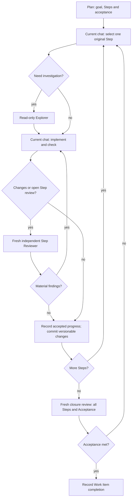

# Benjamin Stelzer

I build Agent Skills that help coding agents make reliable, verifiable changes.
The Scoville Suite is built around Scoville Code's engineering rules, with
Skills for interfaces, planning, review and coordination.

## Why I build these Skills

I'm part of the team at [dynamitec](https://www.dynamitec.de/) and develop
these Skills from my own work with AI agents on real projects.

I keep encountering the same problems: agents adding structure before
understanding the existing code, losing earlier decisions or reporting
results they have not checked.

Scoville Code addresses the engineering side of this. A change needs to solve
the actual problem, fit the codebase and come with evidence of what works
and what remains unchecked.

The other Skills grew from the work around those changes. With Scoville
Workflow, I can now have agents carry out planned tasks over several days
with very little intervention from me. The implementation and review loop
helps catch mistakes before later work builds on them, reducing the risk
of autonomous changes drifting away from the plan.

## How it fits together

Plan records the goal, decisions, original Steps and acceptance criteria. In
Codex, Mainloop keeps planning, implementation and checks in the current chat.
Read-only Explorers investigate questions; fresh independent Reviewers inspect
changed Steps and the complete Work Item. Findings return to one bounded
correction. Accepted progress and versionable changes go into Plan and Git.
Code supplies the engineering rules, and UI adds interface and rendered checks.

A small fix may need only Code, or Code and UI. Longer tasks add planning
and the Workflow loop while retaining the same engineering foundation.

## Scoville Suite

Choose [Scoville Suite for Codex Mainloop](https://github.com/benjaminstelzer/scoville-suite-for-codex-mainloop)
for Codex, or [Scoville Suite](https://github.com/benjaminstelzer/scoville-suite)
for Claude Code and other Agent Skills hosts. Both include Code, Plan, UI,
Handoff, Project Context Cleanup and Skillwriter. Mainloop adds Workflow, Ask
and Setup. It is the maintained Codex edition; migration from earlier copies
is explicit and preserves personal settings.

- [Workflow for Codex](https://github.com/benjaminstelzer/scoville-suite-for-codex-mainloop/tree/main/packages/scoville-workflow-for-codex)
  runs one original Step at a time in the current chat, with read-only Explorers
  and fresh independent Reviewers.
- [Code](https://github.com/benjaminstelzer/scoville-code)
  provides engineering guidance for implementation, diagnosis and review,
  with checks proportionate to the consequences of a mistake.
- [Plan](https://github.com/benjaminstelzer/scoville-plan)
  keeps goals, tasks, decisions and progress available across sessions.
- [UI](https://github.com/benjaminstelzer/scoville-ui)
  covers interface structure, wording, interaction and rendered checks,
  including plugin-owned WordPress admin pages.
- [Handoff](https://github.com/benjaminstelzer/scoville-handoff)
  turns unfinished work into a continuation prompt for requested transfers.
- [Ask for Codex](https://github.com/benjaminstelzer/scoville-ask-for-codex)
  gets independent read-only advice from configured Codex or Claude advisers.
- [Setup](https://github.com/benjaminstelzer/scoville-suite-for-codex-mainloop/tree/main/packages/scoville-setup)
  manages the project's fixed model pairs and explicit legacy migration.

- [Project Context Cleanup](https://github.com/benjaminstelzer/scoville-suite/tree/main/packages/scoville-project-context-cleanup)
  handles requested edits to project rules and index text while preserving meaning,
  scope and record ownership.

- [Skillwriter](https://github.com/benjaminstelzer/scoville-skillwriter)
  writes and reviews Skills and reusable prompts for current frontier models.

Code, Plan, UI, Handoff, Ask and Skillwriter are also available on their own.
Workflow, Setup and Project Context Cleanup come through their suites.

## Applications

- [Plan Viewer downloads](https://github.com/benjaminstelzer/scoville-plan-viewer/releases/latest)
  provides a read-only desktop view of local Plans, progress and Decisions across
  projects. Builds and updates are independent of the Scoville Plan Skill.

## How I work

A new Skill starts with a recurring problem in my own projects. I first check
whether it belongs in an existing Skill. A separate Skill needs a clear
responsibility. Targeted tests cover the boundaries: when it should apply,
when it should stay out and when several Skills need to contribute. The
results help sharpen both the descriptions and the division of work.

Improving existing Skills involves extensive test runs and analyses of complete
project conversations. Over months, I have traced patterns through
implementation, review and correction that an isolated answer would miss:
a plausible result hiding a missed requirement, or a safeguard growing into
layers of checks that cost more than the problem warrants.

Those findings become test cases and corrections to the instructions. I
evaluate the next runs against earlier results, checking the original failure
and effects elsewhere. Repeated searches, unnecessary checks and oversized
output matter because they consume time and context needed for the task.

I use gpt-6.1-sol with low reasoning as the baseline for targeted model tests.
The cases check actual actions, preserved boundaries and whether the result
helps its next recipient. Source review and shorter text alone do not establish
that a model follows the instructions.
